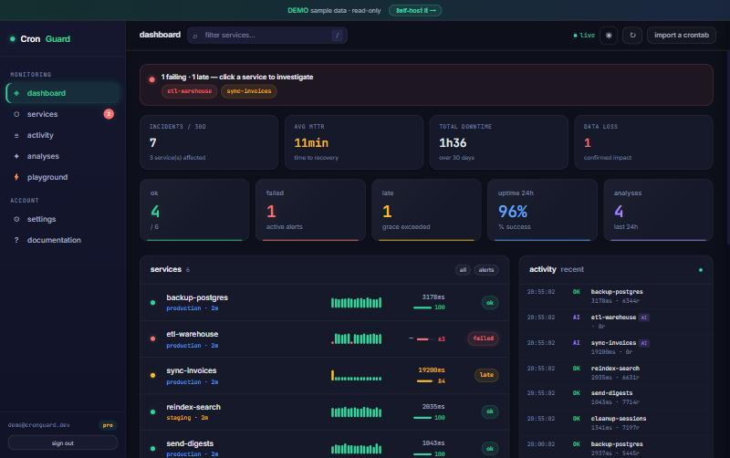

# CronGuard

Surveillance de crons auto-hébergée, qui vous dit pourquoi un job a planté, pas seulement qu'il a planté.

[](LICENSE)
[](https://github.com/Tenerit/cronguard/releases)

🇬🇧 [English version](README.md)



Vous connaissez sûrement celui-là : un script marche très bien quand vous le lancez à la main, puis plante en cron. L'outil de surveillance vous dit que le job est en échec. Reste à vous connecter et à chercher ce qui change.

CronGuard regarde la machine où le job a tourné et vous le dit. Une commande que votre shell trouve mais pas cron, une variable qui n'existe que dans votre `.bashrc`, un chemin relatif, le mauvais utilisateur, un fichier modifié depuis la dernière exécution réussie. Quand il ne sait pas, il le dit au lieu d'inventer.

Tout tourne sur votre serveur. Aucun log ne part chez un tiers, et l'IA est optionnelle et locale.

```text
🟠 backup-db en échec (production)
Cause : votre shell trouve pg_dump dans /usr/lib/postgresql/16/bin, cron non (son PATH est /usr/bin:/bin).
Correction : appeler /usr/lib/postgresql/16/bin/pg_dump, ou définir PATH= en tête de la crontab.
> pg_dump: command not found
[✅ Juste]  [✏️ Corriger]  [Page de statut]
```

## Ce qu'il fait

- Alerte sur les jobs en échec, manqués, en retard, bloqués ou anormalement lents
- À l'échec, le SDK compare l'environnement de cron à votre shell de connexion et vérifie les fichiers cités par l'erreur (lecture seule, aucune valeur envoyée)
- Montre ce qui a changé depuis la dernière réussite : version d'un outil, variable disparue, script modifié
- Lit la ligne de crontab et le script appelé, et signale les pièges classiques avant qu'ils ne cassent (`%` dans la crontab, `docker -it`, `~` entre guillemets, syntaxe bash sous `sh`…)
- Environ 130 pannes de cron connues, avec leur cause et leur correction (PostgreSQL, MySQL, rsync, SSH, certificats, Docker, disque, mémoire…)
- Corrigez un diagnostic depuis l'alerte en un clic : la même panne sera reconnue ensuite sur tous les jobs de l'équipe
- Import d'une crontab ou des timers systemd en une fois
- Slack, Teams, Discord, Google Chat, Mattermost, ntfy, PagerDuty, e-mail, webhooks
- Équipes, rôles, escalade, fenêtres de maintenance, pages de statut, journal d'audit, SSO via votre reverse proxy
- SDK bash, Python, Node.js, et un binaire Go statique

## Démarrage rapide

Il faut une machine Linux avec Docker.

```bash
git clone https://github.com/Tenerit/cronguard && cd cronguard
docker build -f Dockerfile.allinone -t cronguard .
docker run -d --restart unless-stopped -p 3000:3000 -v cronguard-data:/data --name cronguard cronguard
```

Puis ouvrez http://localhost:3000/dashboard :

1. Cliquez sur **No account yet? Create one** et gardez la clé affichée.
2. Cliquez sur **Import a crontab** et collez la sortie de `crontab -l`. Vous récupérez une commande d'installation du SDK et votre crontab avec chaque ligne enveloppée : copiez les deux sur la machine des jobs.
3. Ajoutez un canal d'alerte dans **Settings › Notifications**. [ntfy](https://ntfy.sh) est le plus rapide pour recevoir les alertes sur votre téléphone.

La prochaine panne arrive avec ce que le SDK a vu sur la machine.

Juste pour regarder ? Ouvrez `src/api/dashboard.html?demo=1` dans un navigateur pour une démo en lecture seule, ou lancez `docker compose -f docker-compose.demo.yml up` (clé API `cg_demo_dockerdemo123456`).

## Surveiller un job à la main

```bash
source /usr/local/lib/cronguard.sh
cg_run "votre-cle-de-ping" /scripts/backup.sh
```

Ou depuis n'importe où, avec curl :

```bash
/scripts/backup.sh; curl -fsS http://votre-serveur:3000/ping/votre-cle-de-ping/$?
```

curl ne transmet que la réussite ou l'échec. Les SDK envoient aussi les logs (secrets masqués d'abord sur votre machine) et ce qu'ils ont constaté. Python, Node.js, le binaire Go, les timers systemd, Kubernetes, et `CG_EXPECT` pour les jobs qui « réussissent » sans rien produire : voir [docs/SDK.md](docs/SDK.md) (en anglais).

## Ça marche bien ?

On le teste sur de vraies pannes, pas sur des exemples écrits par nous. Dans trois labos, 28 problèmes de cron ont été tirés au sort sur StackExchange puis rejoués dans un vrai cron Debian. CronGuard en a détecté 19. Quand il a donné une cause, elle était juste 7 fois sur 8 ; le reste du temps, il a dit qu'il ne savait pas.

Son point faible : le job qui sort avec 0 sans avoir fait son travail. `CG_EXPECT` le couvre si vous savez quel fichier le job doit produire.

La méthode, tous les résultats et les essais qui n'ont pas marché sont dans [docs/EVALUATION.md](docs/EVALUATION.md).

## IA locale (optionnelle)

Sans modèle, vous avez tout ce qui précède. Avec un modèle local (`qwen2.5:7b` via Ollama, un CPU suffit), CronGuard reformule aussi la cause établie en langage simple pour la personne d'astreinte. Le modèle ne choisit jamais la cause, et le code rejette toute phrase qui cite quelque chose d'absent des faits. Détails et mesures : [docs/AI.md](docs/AI.md).

## Documentation (en anglais)

- [Brancher ses jobs](docs/SDK.md) : import de crontab, systemd, SDK, ce qu'ils constatent, rapport de pilote
- [Faire tourner CronGuard](docs/OPERATIONS.md) : production, installation isolée du réseau, sauvegardes, alertes, sécurité, métriques, architecture
- [IA locale](docs/AI.md)
- [Comment le diagnostic est mesuré](docs/EVALUATION.md)
- [Déploiement](DEPLOY.md) · [Politique de sécurité](SECURITY.md) · [Journal des changements](CHANGELOG.md)
- [Essai pilote de 14 jours](docs/PILOT.md) (en français)

## Contribuer

Issues et pull requests bienvenues. `npm run ci` lance tout ce qui doit passer : types, les deux suites de tests, l'audit des dépendances, le build et un test de bout en bout sur PostgreSQL et Redis. Voir [CONTRIBUTING.md](CONTRIBUTING.md).

## Licence

[MIT](LICENSE)
