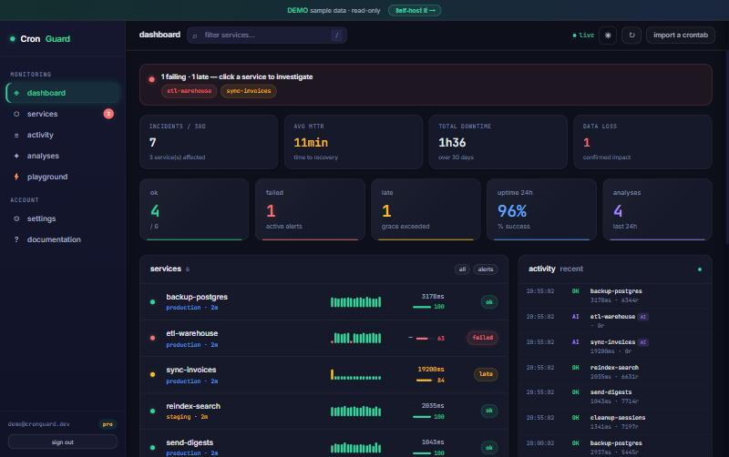

# CronGuard

Self-hosted cron monitoring that tells you why a job failed, not just that it did.

[](LICENSE)
[](https://github.com/Tenerit/cronguard/releases)

🇫🇷 [Version française](README.fr.md)



You've probably had this one: a script works fine when you run it by hand, then fails in cron. The usual monitoring tells you the job is down. You still have to log in and figure out what's different.

CronGuard looks at the machine where the job ran and tells you. A command your shell finds but cron doesn't, an environment variable that only exists in your `.bashrc`, a relative path, the wrong user, a file that changed since the last good run. When it can't tell, it says so instead of guessing.

Everything runs on your server. No logs go to a third party, and the AI part is optional and local.

```text
🟠 backup-db failed (production)
Cause: your shell finds pg_dump in /usr/lib/postgresql/16/bin, cron doesn't (its PATH is /usr/bin:/bin).
Fix: call /usr/lib/postgresql/16/bin/pg_dump, or set PATH= at the top of the crontab.
> pg_dump: command not found
[✅ Right]  [✏️ Correct it]  [Status page]
```

## Features

- Alerts for failed, missed, late, hung and unusually slow jobs
- On failure, the SDK compares cron's environment with your login shell and checks the files the error mentions (read-only, values never sent)
- Shows what changed since the last successful run: a tool version, a missing variable, a modified script
- Reads the cron line and the script it calls, and warns about common traps before they bite (`%` in crontab, `docker -it`, `~` in quotes, bash syntax under `sh`…)
- About 130 known cron failures mapped to their cause and fix (PostgreSQL, MySQL, rsync, SSH, certificates, Docker, disk, memory…)
- Correct a diagnosis from the alert in one click; next time the same failure is recognised on every job of your team
- Import an existing crontab or systemd timers in one go
- Slack, Teams, Discord, Google Chat, Mattermost, ntfy, PagerDuty, email, webhooks
- Teams, roles, escalation, maintenance windows, status pages, audit log, SSO through your reverse proxy
- SDKs for bash, Python, Node.js, plus a static Go binary

## Quick start

You need a Linux machine with Docker.

```bash
git clone https://github.com/Tenerit/cronguard && cd cronguard
docker build -f Dockerfile.allinone -t cronguard .
docker run -d --restart unless-stopped -p 3000:3000 -v cronguard-data:/data --name cronguard cronguard
```

Then open http://localhost:3000/dashboard:

1. Click **No account yet? Create one** and keep the key it shows you.
2. Click **Import a crontab** and paste the output of `crontab -l`. You get back an install command for the SDK and your crontab with each line wrapped. Copy both to the machine that runs the jobs.
3. Add a notification channel in **Settings › Notifications**. [ntfy](https://ntfy.sh) is the quickest way to get alerts on your phone.

The next failure shows up with what the SDK saw on the machine.

Just want to look around? Open `src/api/dashboard.html?demo=1` in a browser for a read-only demo with sample data, or run `docker compose -f docker-compose.demo.yml up` (API key `cg_demo_dockerdemo123456`).

## Monitoring a job by hand

```bash
source /usr/local/lib/cronguard.sh
cg_run "your-ping-key" /scripts/backup.sh
```

Or from anywhere with curl:

```bash
/scripts/backup.sh; curl -fsS http://your-server:3000/ping/your-ping-key/$?
```

curl only reports success or failure. The SDKs also send the logs (secrets masked on your machine first) and what they observed. Python, Node.js, the Go binary, systemd timers, Kubernetes, and `CG_EXPECT` for jobs that "succeed" without producing anything: see [docs/SDK.md](docs/SDK.md).

## How well does it work?

We test it on real failures, not on examples we wrote ourselves. In three labs, 28 cron problems were picked at random from StackExchange and replayed in a real Debian cron. CronGuard caught 19 of them. When it named a cause, it was right 7 times out of 8; the rest of the time it said it didn't know.

Its blind spot is the job that exits with 0 while doing nothing useful. `CG_EXPECT` covers that if you know what file the job should produce.

The method, every result and the experiments that didn't work are in [docs/EVALUATION.md](docs/EVALUATION.md).

## Local AI (optional)

Without a model, you get everything above. With a local model (`qwen2.5:7b` through Ollama, CPU is fine), CronGuard also rewrites the established cause in plain words for whoever is on call. The model never picks the cause, and code rejects any sentence that mentions something not in the facts. Details and measurements: [docs/AI.md](docs/AI.md).

## Documentation

- [Instrumenting jobs](docs/SDK.md): crontab import, systemd, SDKs, what they observe, pilot report
- [Running CronGuard](docs/OPERATIONS.md): production setup, air-gapped install, backups, notifications, security, metrics, architecture
- [Local AI](docs/AI.md)
- [How the diagnosis is measured](docs/EVALUATION.md)
- [Deploying](DEPLOY.md) · [Security policy](SECURITY.md) · [Changelog](CHANGELOG.md)

## Contributing

Issues and pull requests are welcome. `npm run ci` runs what has to pass: types, both test suites, the dependency audit, the build and an end-to-end run on PostgreSQL and Redis. See [CONTRIBUTING.md](CONTRIBUTING.md).

## License

[MIT](LICENSE)
